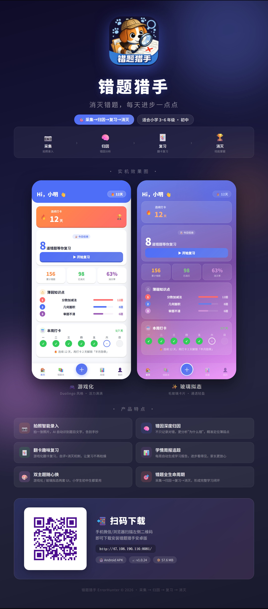

# 🎯 错题猎手 ErrorHunter

> 学生化身猎手，错题是猎物——主动出击，消灭每一道错题，让进步看得见。

面向小学 3-6 年级与初中学生的**错题全生命周期管理 App**：**采集 → 归因 → 复习 → 消灭**。
拍下错题 → OCR 识别 → 归因分类 → 艾宾浩斯间隔复习 → 逐步消灭，让进步看得见。




---

## ✨ 功能特性

- **📸 错题采集**：拍照 → 阿里云读光 OCR 自动识别题目文字；图片裁剪、知识点归类、错因标注。
- **🎯 智能归因**：按错因 / 知识点分类，薄弱知识点可视化（弱项清单）。
- **🔁 间隔复习**：基于艾宾浩斯遗忘曲线的复习调度，今日待复习、复习历史轮次、下次复习时间一目了然。
- **🏆 消灭错题**：复习自评 + 多轮掌握后标记"已消灭"，进度可视化。
- **📊 周报与仪表盘**：自动生成每周学习周报（新增/掌握/复习次数/准确率/首要错因）。
- **🗂️ 对象存储**：题目图片存 MinIO/OSS，存储用量管理、回收站。
- **🔁 离线同步队列**：弱网/离线操作入队，恢复后同步。
- **🔔 复习提醒、打卡连击、PDF 导出、账号注销**等完整体验闭环。

## 🏗️ 技术架构

```
┌─────────────────┐     HTTP/JSON      ┌──────────────────────────────┐
│  Flutter 客户端  │  ◄──────────────► │        Go 后端 (Gin)          │
│  (Android)       │   /v1/* + JWT     │  Handler→Service→Repository   │
└─────────────────┘                   └──────┬───────┬───────┬─────────┘
                                             │       │       │
                                   ┌─────────┴──┐ ┌──┴───┐ ┌─┴──────────┐
                                   │ PostgreSQL │ │ Redis│ │ MinIO / OSS │
                                   │  (错题/用户)│ │(OTP) │ │ (题目图片)  │
                                   └────────────┘ └──────┘ └────────────┘
                                                          ▲
                                          ┌───────────────┴───────────────┐
                                          │ 阿里云：读光 OCR / 号码认证 SMS │
                                          └───────────────────────────────┘
```

**技术栈**

| 层 | 技术 |
|----|------|
| 客户端 | Flutter 3.x、Dart、GoRouter、GetIt、BLoC、sqflite（离线） |
| 后端 | Go 1.21+、Gin、GORM、Viper、zap |
| 存储 | PostgreSQL 16、Redis 7、MinIO（S3 兼容）/ 阿里云 OSS |
| 外部服务 | 阿里云读光 OCR、号码认证服务（SMS OTP） |
| 部署 | Docker Compose、GitHub Actions CI/CD |

## 🚀 快速开始

### 前置依赖

- Go 1.21+、Flutter 3.x（stable）、Docker & Docker Compose
- Android SDK（构建 APK 时）

### 1️⃣ 启动后端 + 依赖（Docker 一键起）

```bash
git clone https://github.com/lawrencehero/ErrorHunter.git ErrorHunter && cd ErrorHunter

cp deploy/.env.example deploy/.env                      # 开发默认值可直接跑
make up                                                  # 起 PG/Redis/MinIO + server
```

启动后：

- API：`http://localhost:8080`
- 健康检查：`curl http://localhost:8080/health`
- MinIO 控制台：`http://localhost:9001`（minioadmin / minioadmin123）

> 后端配置默认走 **mock** SMS/OCR，无需真实阿里云密钥即可联调注册/OCR 流程。

### 2️⃣ 启动客户端

```bash
cd src/errorhunter_app

# 配置 Android SDK 路径（首次）
cp android/local.properties.example android/local.properties
# 编辑 flutter.sdk / sdk.dir 指向本机路径

flutter pub get
flutter run --dart-define=API_BASE_URL=http://localhost:8080/v1
```

客户端默认指向本机后端；连接远程后端用 `--dart-define=API_BASE_URL=http://<your-server>:8080/v1` 覆盖。

> Web/Chrome 调试必须带 `--dart-define`，默认 LAN IP 不可用。

### 3️⃣ 注册登录（mock 模式）

后端 `SMS_PROVIDER=mock` 时，任意手机号收到 OTP 均可在日志或响应中查看（开发联调用）。切换真实短信需在 `.env` 配置 `EH_SMS_ALIYUN_*` 并设 `SMS_PROVIDER=aliyun`。

## 📂 项目结构

```
ErrorHunter/
├── src/
│   ├── errorhunter_app/        # Flutter 客户端（lib/ features: auth/question/review/report/profile/export）
│   └── errorhunter_server/     # Go 后端（cmd/ internal: config/handler/service/repository/model/middleware/pkg）
├── deploy/                     # Docker Compose、Dockerfile、部署脚本（含 prod/ 生产编排）
├── docs/                       # 需求/PRD/技术设计/设计/测试 全套文档（见 docs/README.md）
├── tests/                      # 测试相关
├── Makefile                    # 一键命令（up/down/test/lint/...）
├── LICENSE                     # Apache 2.0
└── NOTICE
```

更多目录说明见 [`docs/README.md`](docs/README.md) 与 [`CLAUDE.md`](CLAUDE.md)。

## 🧪 测试

```bash
# 后端单元 + 集成测试
cd src/errorhunter_server && go test -race -cover ./...

# 客户端
cd src/errorhunter_app && flutter analyze && flutter test

# Docker 集成测试（含独立 test-db）
make test
```

常用 Make 命令：`make help`（列出全部）、`make up/down/logs/status`、`make db-shell`、`make test-coverage`。

## 📖 文档

| 主题 | 路径 |
|------|------|
| 产品需求 PRD | [`docs/03-PRD/PRD-错题猎手-V1.0.md`](docs/03-PRD/PRD-错题猎手-V1.0.md) |
| 技术设计（数据库/API/引擎/架构安全部署） | [`docs/04-技术设计/`](docs/04-技术设计/) |
| OpenAPI 契约 | [`docs/04-技术设计/openapi.yaml`](docs/04-技术设计/openapi.yaml) |
| 界面与交互设计 | [`docs/05-设计/界面与交互设计文档-V1.0.md`](docs/05-设计/界面与交互设计文档-V1.0.md) |
| 测试报告 | [`docs/06-测试/`](docs/06-测试/) |
| 部署指南 | [`deploy/README.md`](deploy/README.md) |

## 🤝 贡献

欢迎贡献！请先阅读 [贡献指南](CONTRIBUTING.md)、[行为准则](CODE_OF_CONDUCT.md)、[安全策略](SECURITY.md)。

提交遵循 [Conventional Commits](COMMIT_CONVENTION.md)。**严禁在 PR 中包含真实密钥、真实用户手机号或生产环境配置。**

## 🗺️ 路线图

- HTTPS 域名与正式上架应用商店
- iOS 端适配
- 错题 AI 归因增强、相似题推荐
- 班级/教师端协同

## 📜 许可证

本项目基于 [Apache License 2.0](LICENSE) 开源。版权 © 2026 ErrorHunter Contributors。

详见 [LICENSE](LICENSE) 与 [NOTICE](NOTICE)。
